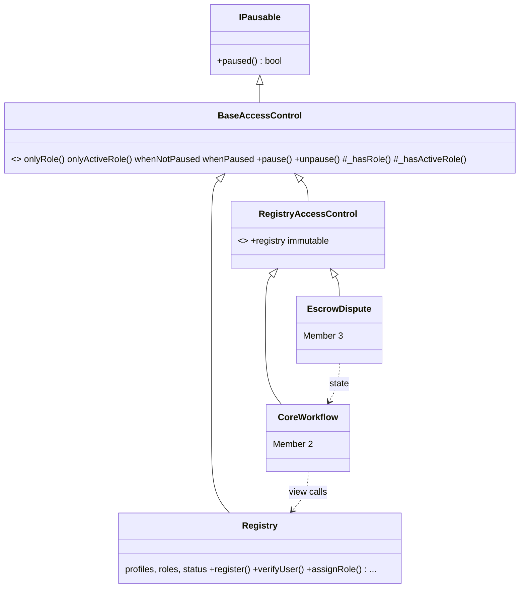

# Integration guide for Members 2 and 3 (read this first, 5 minutes)

> **Caveman version:** Don't write your own "who is allowed" code. Inherit `RegistryAccessControl`, put `onlyActiveRole(...)` on your functions, done. The Registry already knows who is verified, suspended, or what role they have.

## 1. Contract tree



This satisfies the brief's inheritance rule: Workflow and Escrow **inherit** the base through `RegistryAccessControl`; Registry inherits it directly.

## 2. Five steps

```solidity
import {RegistryAccessControl} from "./access/RegistryAccessControl.sol";
import {IRegistry} from "./interfaces/IRegistry.sol";
import {Roles} from "./access/Roles.sol";

contract CoreWorkflow is RegistryAccessControl {
    constructor(IRegistry registry_) RegistryAccessControl(registry_) {}

    function requestLoan(/*...*/) external whenNotPaused onlyActiveRole(Roles.BORROWER) { /* ... */ }
    function approveLoan(uint256 id) external whenNotPaused onlyActiveRole(Roles.VERIFIER) { /* ... */ }
    function fundLoan(uint256 id) external payable whenNotPaused onlyActiveRole(Roles.LENDER) { /* ... */ }
    function resolveDispute(uint256 id) external whenNotPaused onlyActiveRole(Roles.ARBITER) { /* ... */ }
}
```

1. **Inherit** `RegistryAccessControl`, pass the deployed Registry address to the constructor (it is `immutable`).
2. **Gate every state-changing function** with `onlyActiveRole(Roles.X)` (or `onlyActiveRole(Roles.A | Roles.B)` for "either"). Use `onlyRole` only for admin-style recovery actions that must work even for suspended accounts.
3. **Add `whenNotPaused`** to every function that moves money or changes loan state. It is true if *your* contract is paused **or the Registry is paused** (system-wide kill switch).
4. **Do not write role storage, pause logic or admin functions.** `pause()` / `unpause()` come from the base.
5. **Test with the real Registry** (see `test/RegistryAccessControl.test.js` and `contracts/mocks/MockGuarded.sol` for the pattern).

## 3. What you can rely on

| Fact | Detail |
|---|---|
| Roles are `uint8` single-bit flags | `Roles.ADMIN=1, PAUSER=2, VERIFIER=4, LENDER=8, BORROWER=16, ARBITER=32`. A mask like `Roles.VERIFIER \| Roles.ARBITER` means *any of*. **Not** OpenZeppelin `bytes32` roles: if you used OZ `AccessControl` as a stand-in, replace `hasRole(ROLE, who)` with `registry.hasActiveRole(who, Roles.X)` |
| "Active" matters | `hasActiveRole` = status Active **and** role held. Suspended or unverified accounts fail at once in your contract too |
| Revocation is immediate | Role changes in the Registry apply to your next call; no caching |
| Errors | `Unauthorized(address,uint8)`, `EnforcedPause()`, `ExpectedPause()`, `ZeroAddress()` come from the base; ABI-decodable in ethers v6 |
| Events | The Registry emits `RoleGranted/RoleRevoked/UserRegistered/UserVerified/UserSuspended/UserReinstated/Paused/Unpaused`; index them off-chain, do not loop on-chain |
| No ether | Registry never holds funds. Escrow funds are Member 3's responsibility (use checks-effects-interactions and a reentrancy guard there) |

## 4. Registry view functions you may call

`hasRole(addr, mask)`, `hasActiveRole(addr, mask)`, `isActive(addr)`, `statusOf(addr)`, `rolesOf(addr)`, `getProfile(addr)`, `admin()`, `pendingAdmin()`. Your contract inherits the wrappers, so usually you only need the modifiers. For a check inside a function body: `registry.hasActiveRole(borrower, Roles.BORROWER)` (e.g. to confirm a *counterparty* is an Active lender).

## 5. Frozen interface rule

`IRegistry.sol`, `IPausable.sol`, `Roles.sol` and the modifier names in `BaseAccessControl.sol` are **frozen** (Gate 0). Changes need all three members to agree, announced the same day, mocks updated the same day.

## 6. Deploy order (for Member 3's script)

1. `deployRegistry(admin)` from `scripts/lib/deployRegistry.js`
2. `new CoreWorkflow(registry)`
3. `new EscrowDispute(registry, workflow)`
4. Export ABIs (`npm run abi` exports the Registry ABI; extend `scripts/export-abi.js` for the others) and write addresses to `frontend/deployment.json`.

## 7. Frontend slots

`frontend/index.html` has a "Your workspace" card with empty slots per role (`slotBorrower`, `slotLender`, `slotArbiter`). Add your screens inside them; reuse `sendTx(title, fn, args)` in `app.js`, which does the pre-flight check, status messages and decoded contract errors. If you pass another contract through it, make `state.registry`-style contract objects for your ABIs and decode your errors with the same `findRevertData` helper.
