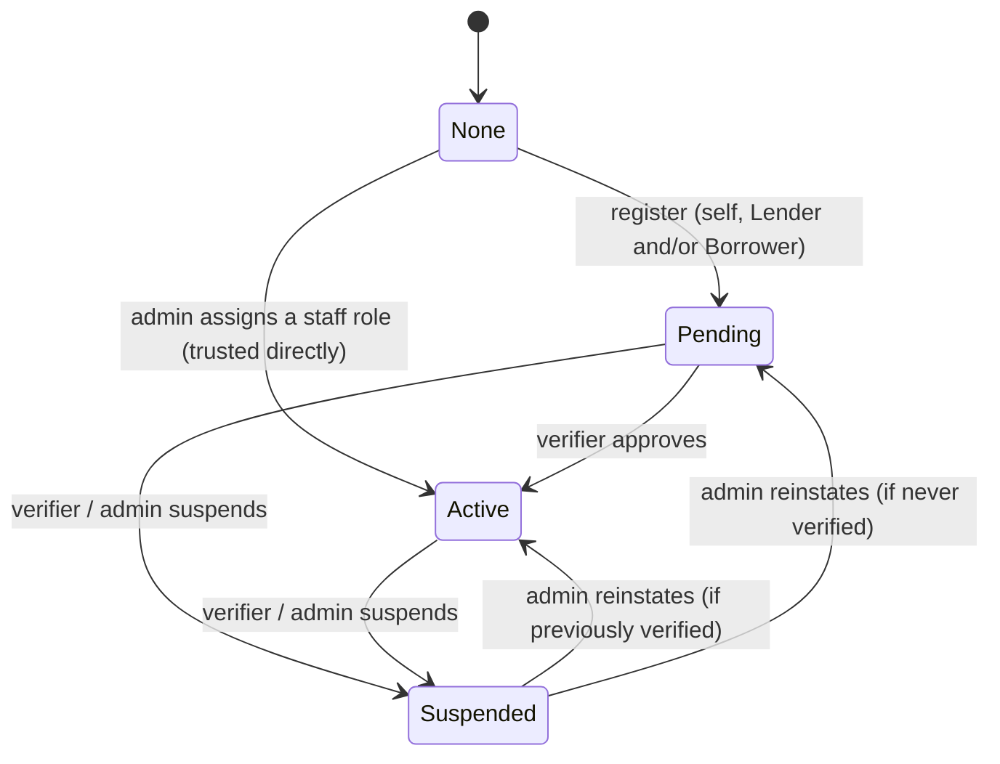
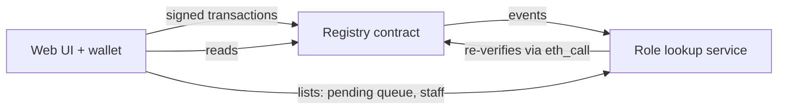

# Report section: Use case and blockchain justification (Member 1)

## 1. Problem statement

Small loans between individuals and small businesses are hard to arrange safely. Banks are slow and expensive for small amounts and often refuse people without collateral. Informal lending relies on personal trust: there is no shared record of who lent what, no neutral holder of the money while a deal is pending, and disputes come down to one person's word against another's.

**TrustLend** is a peer-to-peer lending platform. Lenders offer funds, verified borrowers request loans, the money is held by a smart contract until conditions are met, repayments are recorded, and disputes go to an arbiter. The contracts play the role of the bank's back office.

## 2. Why a blockchain (and where not)

| Need | Why a blockchain fits | Why a normal database is weaker |
|---|---|---|
| Lender and borrower do not trust each other, and neither wants to trust a platform owner with the money | Rules (funding, release, repayment) run as code that all parties can read; funds sit in a contract, not in the operator's account | The operator could freeze, redirect or alter balances |
| One shared, tamper-evident history of identities, approvals, loans and repayments | Append-only ledger plus events; every role change and approval is permanently attributable to a wallet | Logs can be edited by whoever controls the server |
| Several independent organisations act on the same records (lenders, verifiers, arbiters) | One shared state without a single owner of the database | Needs a trusted third party to host and arbitrate |
| Permissions must be auditable | Role grants and revocations are public events | Admin changes can be hidden |

**Where blockchain is NOT used (deliberately):** KYC documents and personal data (privacy law, cannot be deleted from a chain), credit scoring, notifications and search. Only a **salted hash** of the KYC record is stored on-chain, which commits the verifier and applicant to one specific record without revealing it.

## 3. Actors and roles (the role model Member 1 implements)

| Role | Who | Can do | Cannot do |
|---|---|---|---|
| Admin | Platform operator | Grant/revoke staff roles, suspend/reinstate users, resume after pause, hand over admin | Be suspended; grant a second ADMIN directly |
| Pauser | Security officer | Trigger emergency pause | Resume; change roles |
| Verifier | Credit/KYC officer | Approve Pending users; suspend ordinary users | Approve themselves; suspend staff or admin |
| Lender | Public user | Supply funds (Members 2/3) | Anything until Active |
| Borrower | Public user | Request and repay loans (Members 2/3) | Anything until Active |
| Arbiter | Dispute resolver | Resolve disputes (Member 3) | Anything until Active |

## 4. Workflows (at least three, as required)

| # | Workflow | Owner | Summary |
|---|---|---|---|
| W1 | **Onboarding and KYC** | Member 1 | Wallet registers as Lender/Borrower with a salted KYC hash (Pending) -> Verifier checks documents off-chain -> approves (Active) |
| W2 | Loan request, approval, funding | Members 2/3 | Active borrower requests loan -> verifier approves -> lender funds into escrow -> borrower receives funds |
| W3 | Repayment | Members 2/3 | Borrower repays into escrow -> lender can withdraw principal + interest |
| W4 | Dispute / default | Member 3 | Either party raises dispute -> arbiter decides -> escrow releases accordingly |
| W5 | **Access management and emergency control** | Member 1 | Admin grants/revokes staff roles, suspends bad actors; Pauser stops the platform; Admin resumes |

### User lifecycle (implemented and tested)

Design point: a reinstated user who was **never verified** returns to Pending, so suspension cannot be used as a way around KYC.

## 5. Data placement (Member 1 part)

| Data | Where | Why |
|---|---|---|
| Wallet address, status, role bits, timestamps | On-chain (`Registry`) | Needed by contracts to authorize actions; must be tamper-evident |
| `kycRef` = keccak256(KYC record + secret salt) | On-chain | Commitment: proves which record was approved without exposing it; salt prevents guessing from low-entropy documents |
| KYC document, name, salt | Off-chain (applicant and verifier only) | Personal data; never on-chain |
| "Who holds role X", "who is pending" lists | Rebuilt off-chain by the role service from events, re-verified on-chain | Saves gas (no on-chain arrays); contract remains source of truth |

## 6. Hybrid flow (Member 1 part)

Trust and failure handling: the service is read-only and holds no keys. It uses events only to find *candidates* and re-reads every answer from the contract at one pinned block, so a stale cache cannot grant anyone a role. If the service or RPC node is down the UI shows a banner and all on-chain actions still work; the service returns HTTP 503 `retryable` for node outages.
